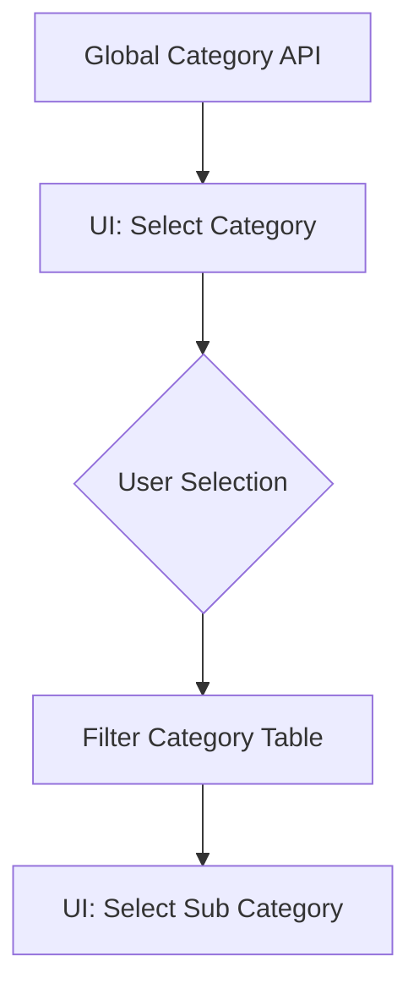

# Frontend Technical Deep Dive

## 1. Feature-Based Architecture
The application is logic-grouped rather than type-grouped. Look inside `src/features/` for the core code.

### Anatomy of a Feature (e.g., `features/Inventory`)
- **`api/`**: Contains `<feature>.api.ts`. This file holds all Axios calls to the backend. No data fetching should happen directly in components.
- **`components/`**: Feature-specific UI like tables, modals, or specialized input fields.
- **`screens/`**: The top-level pages. These screens pull data using hooks/API and pass it down to components.
- **`types/`**: TypeScript interfaces defining what a "Product" or "StockItem" looks like to the frontend.

## 2. Component Data Flow
1. **Request**: A screen (like `AddProduct.tsx`) calls `productsApi.create(payload)`.
2. **Execution**: The API service in `src/features/Product/api/product.api.ts` makes the POST request to the backend.
3. **Internal State**: The screen uses `useState` to manage form data and `useEffect` to fetch initial data (like Categories) on page load.
4. **Validation**: Before sending to the API, the screen checks if required fields like SKU and Category are filled.

## 3. The "Category" UI Mapping
To match the backend's hierarchy, the frontend uses two separate dropdowns:

- **Selection 1 (Label: Category)**: Populates from the `global_category` backend table.
- **Selection 2 (Label: Sub Category)**: Populates from the `category` backend table, filtered by the ID of the first selection.

## 4. State Management & Hooks
- **React Context**: Used for global states like User Authentication and Theme.
- **Local State**: Managed via standard `useState` and `useReducer` for complex forms.
- **Custom Hooks**: Found in `src/hooks/`, these contain shared logic like scanning detection or window resizing.

## 5. Styling & UI Components
- **Tailwind CSS**: Used for 90% of the styling. Configuration is in `tailwind.config.js`.
- **Lucide Icons**: Standardized icon set for the entire app.
- **Reusable UI**: Found in `src/components/`, these are generic elements like `Button`, `Modal`, and `Table` that are used across all features.
